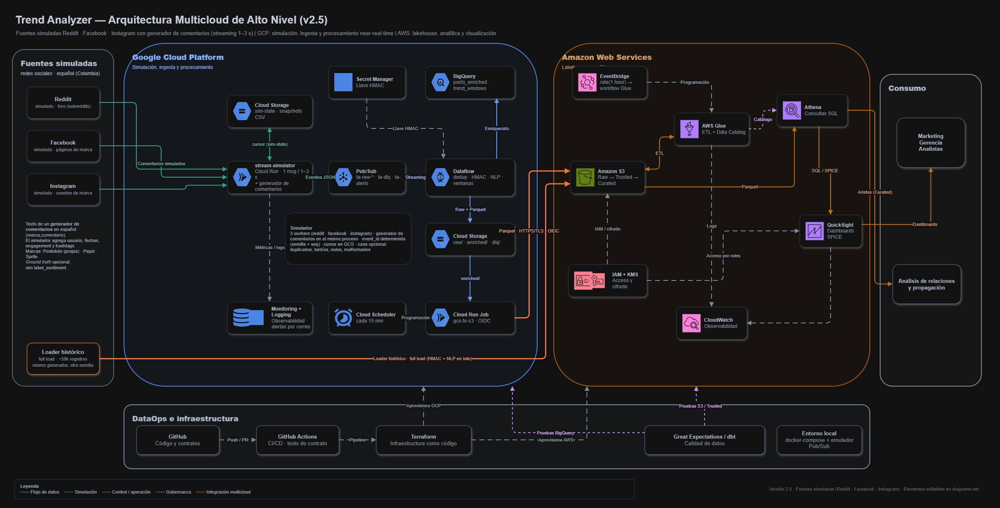

# TrendAnalyzer

> Plataforma de analisis de tendencias y sentimiento en redes sociales y medios digitales.  
> **Asignatura:** SI4002 -- Proyecto de Ingenieria de Datos · Universidad EAFIT · 2026-2  
> **Profesor:** Jose Fabio Jaramillo Castro

---

## Descripcion

**TrendAnalyzer** centraliza y procesa comentarios sobre una marca, sus productos y sus competidores para apoyar los procesos de investigacion de mercado y toma de decisiones de una empresa colombiana simulada del sector de bebidas y productos de consumo masivo. Las marcas simuladas son **Postobon (marca propia)**, **Pepsi** y **Sprite** (competidores).

Como las APIs reales de Reddit, Facebook e Instagram imponen aprobaciones y limites de acceso, el **streaming se simula**: un generador de comentarios en Python (`marca,comentario`) alimenta tres fuentes simuladas -- **Reddit, Facebook e Instagram** -- que publican a Pub/Sub cada 1-3 s. La plataforma anonimiza, aplica NLP preentrenado en espanol para estimar sentimiento y emocion, identifica tendencias emergentes y genera alertas (por correo) ante cambios en la conversacion digital.

> Todo lo que ocurre despues de Pub/Sub es igual al pipeline que se usaria con fuentes reales; lo unico simulado es el origen del dato.

---

## Documentacion

| Documento | Contenido |
|---|---|
| [`docs/INFORME.md`](docs/INFORME.md) | **Informe tecnico final**: arquitectura, decisiones, KPIs medidos con su evidencia, limitaciones y modelos |
| [`docs/SUSTENTACION.md`](docs/SUSTENTACION.md) · [`docs/DEMO.md`](docs/DEMO.md) | Guion de la sustentacion (7 etapas, plan B, registro del ensayo) y guion de la demo en vivo |
| [`docs/RUNBOOK.md`](docs/RUNBOOK.md) | Operacion: encender y apagar, reiniciar el simulador, reprocesar desde `raw/`, DLQ y respuesta a cada alerta |
| [`docs/ARCHITECTURE.md`](docs/ARCHITECTURE.md) | **Fuente de verdad** (version vigente 2.62): arquitectura, contratos de comunicacion (sec. 5), decisiones (ADR), riesgos y preguntas abiertas |
| [`docs/PLAN.md`](docs/PLAN.md) | Plan por fases y lotes, matriz de trazabilidad Fase · Lote -> HU y estado del proyecto (sec. 3) |
| [`docs/CHANGELOG.md`](docs/CHANGELOG.md) | Historial de versiones (v2.2 -> v2.62), una entrada por version |
| [`docs/HU.md`](docs/HU.md) | Backlog: 48 historias de usuario (HU-001 a HU-048) con criterios de aceptacion |
| [`docs/GOVERNANCE.md`](docs/GOVERNANCE.md) · [`docs/CATALOG.md`](docs/CATALOG.md) · [`docs/LINEAGE.md`](docs/LINEAGE.md) | Gobierno de datos (DAMA-DMBOK, Ley 1581), catalogo y linaje |
| [`docs/ACTIVE_SERVICES.md`](docs/ACTIVE_SERVICES.md) | Que cuesta dinero y como encender, comprobar y apagar cada servicio, en local y en GCP |
| [`docs/validation/`](docs/validation/) | Guias de validacion paso a paso, una por lote (`validation-2-2.md` a `validation-8-1.md`) |
| [`project/LOCAL_DEV.md`](project/LOCAL_DEV.md) | Entorno local sin nube: emulador de Pub/Sub, simulador y validador |
| [`project/infra/BOOTSTRAP.md`](project/infra/BOOTSTRAP.md) · [`project/infra/DEPLOY_SIMULATOR.md`](project/infra/DEPLOY_SIMULATOR.md) | Bootstrap de Terraform (Lote 1.0) · base de GCP y despliegue del simulador (Lote 1.3) |
| [`project/src/streaming/README.md`](project/src/streaming/README.md) · [`ENRICHED.md`](project/src/streaming/ENRICHED.md) | Pipeline de streaming (Lote 2.1) · rama enriched: anonimizacion, `enriched/` y BigQuery (Lote 2.2) |
| [`docs/GLOSSARY.md`](docs/GLOSSARY.md) | Glosario del proyecto |
| [`docs/NOTAS.md`](docs/NOTAS.md) | Notas de trabajo |
| [`docs/trend_analyzer_multicloud.drawio`](docs/trend_analyzer_multicloud.drawio) | Diagrama editable en [diagrams.net](https://app.diagrams.net) (v2.5) |
| [`docs/trend_analyzer_multicloud.jpg`](docs/trend_analyzer_multicloud.jpg) | Exportacion del diagrama |



---

## Arquitectura

```
  Reddit · Facebook · Instagram   (simulados)
        │  generador de comentarios:  marca,comentario
        ▼
  Cloud Run  ta-stream-simulator   (1 mensaje cada 1-3 s por fuente)
        │
        ▼
  ┌─ Google Cloud Platform · ingesta y near-real-time ───────────────────┐
  │ Pub/Sub ──► Dataflow (validar · dedup · anonimizar · NLP · ventanas) │
  │               ├──► BigQuery (posts_enriched · trend_windows)         │
  │               └──► Cloud Storage (raw · enriched · dlq)              │
  │ Cloud Scheduler ──► Cloud Run Job gcs-to-s3                          │
  │ Secret Manager (llave HMAC) · Monitoring + Logging (alertas correo)  │
  └──────────────────────────────────────────────────────────────────────┘
        │ Parquet · cada 15 min (HTTPS/TLS · OIDC)
        ▼
                      ┌─ Amazon Web Services · lakehouse y analitica ──────────────┐
                      │ S3 (Raw → Trusted → Curated) · Glue ETL · Athena           │
  Loader historico ──►│ QuickSight (dashboards) · EventBridge (cada hora)          │
  (mismo generador)   │ CloudWatch · IAM + KMS                                     │
                      └────────────────────────────────────────────────────────────┘
        │
        ▼  Consumo
  Marketing · Gerencia · Analistas · Analisis de relaciones
```

**GCP** es el plano de ingesta y procesamiento near-real-time. **AWS** es el Lakehouse y la capa analitica. El detalle (diagrama Mermaid, contratos y decisiones) esta en [`docs/ARCHITECTURE.md`](docs/ARCHITECTURE.md).

**Que funciona (v2.61, todos los lotes cerrados):** simulador -> Pub/Sub -> Dataflow (validacion, deduplicacion, DLQ, anonimizacion, NLP y ventanas de tendencias) -> GCS y BigQuery (`posts_enriched`, `trend_windows`) -> alertas por correo en menos de 5 minutos. Cada 15 minutos el exportador lleva `enriched/` a S3, donde Glue construye Raw -> Trusted -> Curated (con el historico de 180 dias) y Athena y QuickSight sirven el tablero. Calidad con Great Expectations, catalogo y linaje; CI en GitHub Actions; tableros y alertas de operacion y de gasto. El ensayo completo de la sustentacion en la nube salio bien el 29-oct-2026 (ver `docs/SUSTENTACION.md`).

---

## Entornos

| Elemento | Valor |
|---|---|
| Proyecto GCP | `project-0568d9ba-848f-413c-88b` (nombre `proyectoDatos`, numero `63567159332`; facturacion con credito, a cargo de Alejandro Sepulveda) |
| Region GCP | `us-central1` (ADR-12; cuotas de vCPU y Dataflow verificadas en esa region) |
| Region AWS | `us-east-1` (el ID de cuenta va en `terraform.tfvars`, no en el repositorio) |
| Simulador | Cloud Run `ta-stream-simulator` (`min = max = 1`, CPU siempre asignada). Apagado por defecto (`simulator_running = false`); el cursor se conserva en GCS |
| Streaming | Dataflow `ta-stream-dev`: 1 × `e2-standard-2`, Streaming Engine. Workers con la imagen `dataflow-nlp` (Artifact Registry `ta-images`). Se drena fuera de validaciones y demos |
| Datos en GCP | Buckets `…-ta-lake` (`raw/`, `dlq/`, `enriched/`) y `…-ta-datasets` (cursor del simulador) · BigQuery `ta_stream.posts_enriched` · secreto `ta-hmac-key` |
| Costos mientras estan encendidos | Dataflow ~0,25 USD/h · simulador: una instancia siempre encendida · Cloud Build ~0,10 USD por imagen de NLP |
| Etiquetas | `project=trend-analyzer` · `env=dev` · `owner=alejandro` · `component=<pieza>` (Lote 7.3; `project` activa como etiqueta de costos en AWS Billing) |
| Alertas | Correo, via Cloud Monitoring (las direcciones van en `terraform.tfvars`). Por ahora un solo destinatario |
| Autenticacion de Terraform | AWS: perfil local de AWS CLI (`aws configure`). GCP: Application Default Credentials (`gcloud auth application-default login`). Sin llaves en el codigo |
| Estado de Terraform | Remoto (ADR-14): GCS con versionado (GCP) y S3 con bloqueo en DynamoDB (AWS, ADR-15). Los *bootstraps* ya estan aplicados (Lote 1.0) |
| Presupuestos | GCP (400000 COP) y AWS (50 USD) con aviso por correo al 50 %, 80/90 % y 100 % del gasto |
| Codigo | Python 3.11 · Apache Beam 2.77 · Terraform >= 1.6. En WSL el 3.11 se instala con `uv`: entorno `ta` (simulador y `common/`) y `~/.venvs/ta-streaming` (Beam y validaciones) |

---

## Fuentes de datos

| Fuente | Mecanismo | Frecuencia | Estado |
|---|---|---|---|
| **Reddit** (simulado) | Worker del `ta-stream-simulator` -> Pub/Sub `ta-raw-reddit` · payload estilo Reddit (subreddit, score, num_comments) · 30% posts / 70% comentarios | 1 mensaje cada 1-3 s | Operativa (Lotes 1.2 y 1.3) |
| **Facebook** (simulado) | Worker del `ta-stream-simulator` -> Pub/Sub `ta-raw-facebook` · payload estilo Meta (pagina, reacciones, shares) · 15% posts / 85% comentarios | 1 mensaje cada 1-3 s | Operativa (Lotes 1.2 y 1.3) |
| **Instagram** (simulado) | Worker del `ta-stream-simulator` -> Pub/Sub `ta-raw-instagram` · payload estilo Meta (cuenta, media, like_count) · 100% comentarios | 1 mensaje cada 1-3 s | Operativa (Lotes 1.2 y 1.3) |
| **Historico** | Mismo generador en batch (ultimos 180 dias) -> S3 `raw/origin=historical/` | Manual / one-shot | Cargado (Lote 3.1): 12.102 objetos en `raw/`, mismo esquema que el streaming |

### Generador de comentarios

El texto de todas las fuentes sale de un generador de Python (entregado en el Lote 1.1) que produce pares `marca,comentario` en espanol colombiano (jerga, emojis, abreviaturas) en 5 categorias: `gusto`, `asco`, `informativo`, `nostalgia` y `adiccion`. El CLI `scripts/generate_comments.py` escribe un CSV con las columnas `marca,comentario,sentimiento[,categoria]`; `marca` lleva la clave canonica (`postobon`, `pepsi`, `sprite`), no el nombre con tilde:

```csv
marca,comentario,sentimiento
postobon,Opinión personal: soy fan d Postobón y no pienso cambiar. Volvería mil veces. 🙌,positive
pepsi,Mi aporte del día: no tolero Pepsi Cola en el trancón. Mejor me hubiera tomado un agua. Es mi opinión.,negative
sprite,Vamos al punto: me chifla Sprite sobre todo con el frío de Bogotá. Eso sí es sabor. 🥤,positive
```

> Ejemplo ilustrativo del formato; el texto real depende de la semilla.

El simulador agrega lo que el texto no trae (red social, usuario, fechas, engagement, hashtags) y controla que marca se menciona en cada momento para crear tendencias reproducibles.

**Decisiones adoptadas sobre el generador** (detalle en `docs/ARCHITECTURE.md` sec. 3.2.1, 3.2.2 y ADR-13):

| Tema | Decision |
|---|---|
| Marcas v1 | `postobon` (propia), `pepsi` y `sprite` (competidores). CocaCola y Colombiana quedan fuera de v1 |
| Sentimiento (*ground truth*) | `gusto` -> positive · `asco` -> negative · `informativo` -> neutral · `nostalgia` y `adiccion` -> sin etiqueta |
| Funcion pura | `generate(rng, marca, sentimiento)` con `random.Random` inyectado; sin `sleep`, `print` ni semilla global |
| Variedad | Categoria `informativo` (40 plantillas) y 18 plantillas comparativas con dos marcas ("Pepsi vs Postobon"); 99,995 % de textos unicos en 20.000 comentarios |
| Mezcla de categorias | Sin sentimiento fijo: `gusto` 28 % · `asco` 24 % · `informativo` 18 % · `nostalgia` 15 % · `adiccion` 15 %. 30 % de los `informativo` son comparativas |
| Ruido | Probabilidad de ruido 20 %; nunca quita la marca del texto. Los hashtags del texto se extraen con regex y se normalizan (minusculas, sin `#`, sin tildes, maximo 100 caracteres) |
| Reproducibilidad | `Random(f"{semilla}|{fuente}|{seq}")` por evento; `event_id` determinista |

> Los datos son 100% sinteticos: la asociacion marca-sentimiento es artificial y las metricas de NLP seran optimistas. El objetivo del proyecto es ingenieria de datos (ingesta, calidad, linaje, latencia), no conclusiones de negocio.

---

## Stack tecnologico

| Capa | Tecnologias |
|---|---|
| **Ingesta** | Cloud Run (`ta-stream-simulator`, Python 3.11 · asyncio) · generador de comentarios · Pub/Sub |
| **Procesamiento** | Dataflow (Apache Beam 2.77, Streaming Engine) · AWS Glue (Spark) |
| **NLP** | RoBERTuito (pysentimiento): sentimiento y emocion en espanol, con `RunInference` en Dataflow y los modelos horneados en la imagen `dataflow-nlp` |
| **Almacenamiento Raw** | Cloud Storage (GCS) · Amazon S3 |
| **Analitica** | BigQuery · Amazon Athena |
| **Orquestacion** | Cloud Scheduler · Amazon EventBridge |
| **Gobernanza** | AWS Glue Data Catalog · dbt docs (linaje) · DAMA-DMBOK |
| **Calidad** | Great Expectations · dbt · verificadores por lote (`verify_*.py`) · validaciones automaticas (`validate_*.py`) · prueba de humo end-to-end · contratos verificados con `jsonschema` |
| **Seguridad** | Secret Manager (llave HMAC de anonimizacion) · IAM + KMS (AWS) · gitleaks (pre-commit) |
| **IaC / CI-CD** | Terraform >= 1.6 (estado remoto: GCS y S3 + DynamoDB) · GitHub Actions · Docker · Cloud Build · Artifact Registry |
| **Desarrollo local** | Docker Compose · emulador de Pub/Sub · Dataflow `DirectRunner` (tambien con NLP) |
| **Visualizacion** | Amazon QuickSight |
| **Observabilidad** | GCP Monitoring + Logging (alertas por correo) · AWS CloudWatch |

> Fuera del alcance v1: Firestore, Cloud SQL, Neptune y Dataplex (el analisis de relaciones se cubre con tablas de aristas en Curated). Ver `docs/ARCHITECTURE.md` sec. 1.3.

---

## Estructura del repositorio

> Estructura principal (v2.61). Rutas completas en `docs/ARCHITECTURE.md` sec. 6.

```
.                                          <- raiz del repositorio
├── README.md                              <- este archivo
├── .gitignore                             <- incluye terraform.tfvars
├── .pre-commit-config.yaml                <- gitleaks, formato
├── .github/workflows/                     <- ci.yml (pruebas, Terraform, imagenes, gitleaks) y cd.yml (OIDC; apagado)
│
├── docs/
│   ├── INFORME.md  SUSTENTACION.md  DEMO.md  RUNBOOK.md   <- informe final, guiones y operacion (Lote 8.1)
│   ├── ARCHITECTURE.md                    <- arquitectura y contratos (version vigente)
│   ├── CHANGELOG.md                       <- historial de versiones
│   ├── PLAN.md                            <- fases y lotes, matriz HU y estado del proyecto
│   ├── HU.md                              <- historias de usuario (HU-001 a HU-048)
│   ├── GOVERNANCE.md  CATALOG.md  LINEAGE.md              <- gobierno, catalogo y linaje (Lote 5.3)
│   ├── ACTIVE_SERVICES.md                 <- encender, comprobar y apagar lo que cobra
│   ├── validation/                        <- guias de validacion por lote (validation-2-2.md a validation-8-1.md)
│   ├── GLOSSARY.md                        <- glosario del proyecto
│   ├── NOTAS.md                           <- notas de trabajo
│   ├── trend_analyzer_multicloud.drawio   <- diagrama editable (v2.5)
│   └── trend_analyzer_multicloud.jpg      <- exportacion del diagrama
│
└── project/                               <- codigo, contratos e infraestructura
    ├── docker-compose.yml                 <- local: emulador Pub/Sub + simulador + validador (Lote 1.5)
    ├── docker-compose.dataflow.yml        <- local: dataflow-local (DirectRunner) y streaming-check (Lote 2.1)
    ├── docker-compose.nlp.yml             <- local: dataflow-local con la imagen de NLP (Lote 2.3)
    ├── LOCAL_DEV.md                       <- guia del entorno local
    ├── local/                             <- Dockerfiles de las herramientas locales
    ├── pytest.ini                         <- pythonpath = src, testpaths = src
    ├── contracts/                         <- copia legible por maquina de la sec. 5 (schemas, DDL de BigQuery y Athena, ejemplos, pruebas)
    ├── infra/                             <- Terraform de GCP y AWS: bootstrap, entornos dev y un modulo por pieza (Pub/Sub, BigQuery, Cloud Run, Glue, Athena, QuickSight, alertas, observabilidad, costos, CD)
    │   ├── BOOTSTRAP.md  DEPLOY_SIMULATOR.md  validate.sh
    │   ├── gcp/{bootstrap,modules,environments/dev}/
    │   └── aws/{bootstrap,modules,environments/dev}/
    ├── scripts/
    │   ├── on.py  off.py  status.py       <- encender, apagar y ver lo que cobra
    │   ├── demo_scenario.py               <- ola de demo con su alerta (Lote 6.3)
    │   ├── smoke_e2e.py                   <- prueba de humo extremo a extremo (Lote 5.4)
    │   ├── kpi_report.py  quicksight.py   <- tabla de KPI del informe (8.1) · tablero y refresco de SPICE (6.1)
    │   ├── load_historical.py  export_gcs_to_s3.py   <- historico (3.1) y puente GCS -> S3 (3.2)
    │   ├── generate_comments.py  build_*_image.sh  dataflow_job.sh  local_*.sh  verify_*.py
    │   └── validate_2_3.py ... validate_8_1.py       <- una validacion automatica por lote
    ├── evidencia/                         <- JSON y logs que dejan las validaciones (fuente de la tabla de KPI)
    └── src/
        ├── conftest.py  setup.py          <- fixtures de contratos · paquete que Dataflow instala en los workers
        ├── common/                        <- envelope, hashing, hashtags, label_map, fila enriquecida, Parquet y llave HMAC
        ├── simulator/                     <- ta-stream-simulator: generador, caos, escenario de demo y Dockerfile (Fase 1, Lote 6.3)
        ├── ingest_check/                  <- verificador de ingesta y topologia del emulador (Lotes 1.4 y 1.5)
        ├── streaming/                     <- Dataflow: validacion, dedup, DLQ, anonimizacion, NLP y ventanas de tendencias (Fase 2)
        ├── historical/  exporter/         <- full load historico (3.1) · gcs-to-s3 (3.2)
        ├── lakehouse/                     <- Glue jobs Raw -> Trusted -> Curated, Athena y orquestacion (Fase 4)
        ├── quality/  dq/                  <- profiling y Great Expectations (Fase 5)
        ├── smoke/                         <- prueba de humo extremo a extremo (Lote 5.4)
        ├── serving/                       <- tablero de QuickSight (Lote 6.1)
        ├── alerts/  demo/                 <- notificador de alertas (6.2) · cliente del escenario de demo (6.3)
        ├── report/                        <- KPIs del informe desde la evidencia (Lote 8.1)
        └── ops/                           <- operacion (on/off/status) y validaciones automaticas
```

> **`LocalContext/`** (si existe en tu copia local) contiene documentos de referencia que no se suben al repositorio (ver `.gitignore`). `FUENTES.md` y `tanteo_fuentes.py` corresponden al enfoque anterior (Mastodon/Reddit/RSS reales).

---

## Equipo

| Integrante | Rol | Responsabilidades |
|---|---|---|
| **Miguel Alejandro Gomez Duque** | Lider Tecnico · Arquitecto · DataOps | Arquitectura GCP/AWS · IAM · Lakehouse · Scrum Master · Git · CI/CD · Observabilidad |
| **Camila Martinez Montoya** | Ingeniero de Pipelines / Big Data | ETL/ELT · Dataflow · Spark/Flink · DAGs · Kafka/Pub/Sub |
| **Alejandro Sepulveda Posada** | Gobernanza y Calidad · Simulador | Simulador de streaming y generador de comentarios (Reddit/Facebook/Instagram) · Profiling (HU-031) · Calidad (HU-032) · DAMA-DMBOK · Catalogo · Linaje · Ley 1581 · Facturacion/credito GCP |

> Por ahora solo el correo de Alejandro tiene acceso al proyecto y recibe alertas; el acceso de Miguel y Camila se otorga cuando lo necesiten sus lotes (HU-046).

---

## Entregas

El plan ya no usa fechas (ver `docs/CHANGELOG.md`, v2.10): las entregas se definen por contenido.

| Entrega | Peso | Entregable |
|---|---|---|
| **Sprint 0** | 10% | Propuesta · Canvas · arquitectura conceptual · KPIs · data assessment |
| **Sprint 1** | 30% | Infra provisionada · ingesta funcional · capa Raw · profiling · calidad basica |
| **Sprint 2** | 30% | Pipelines ETL/ELT · bases optimizadas · catalogo · linaje · serving layer |
| **Sprint Final** | 30% | CI/CD · monitoreo · dashboard gobernado · informe tecnico · sustentacion |

---

## Estado del proyecto

Plan por fases (detalle y lotes en [`docs/PLAN.md`](docs/PLAN.md) sec. 1; estado vivo, lote por lote, en sec. 3):

| Fase | Contenido | HU | Estado |
|---|---|---|---|
| 0 · Alineacion | Contratos, README y diagrama, decisiones | HU-001 a HU-003 | ✅ Cerrada |
| 1 · Simulador | Bootstrap, generador, simulador, despliegue, verificador, entorno local | HU-004, HU-008 a HU-017, HU-046, HU-047 | ✅ Cerrada (v2.21) |
| 2 · Streaming GCP | Dataflow, anonimizacion, NLP, ventanas | HU-005, HU-018 a HU-023 | ✅ Cerrada (v2.27) |
| 3 · Historico y puente | Full load y exportador GCS -> S3 | HU-006, HU-024, HU-025 | ✅ Cerrada (v2.31) |
| 4 · Lakehouse AWS | Trusted, Curated, aristas, orquestacion | HU-007, HU-026 a HU-030 | ✅ Cerrada (v2.40) |
| 5 · Calidad y gobernanza | Profiling, reglas, catalogo, linaje, prueba E2E | HU-031 a HU-036, HU-048 | ✅ Cerrada (v2.46) |
| 6 · Serving y alertas | QuickSight, alertas, escenarios de demo | HU-037 a HU-040 | ✅ Cerrada (v2.53) |
| 7 · CI/CD y costos | Actions, observabilidad, presupuesto | HU-041 a HU-043 | ✅ Cerrada (v2.60); el CD esta escrito y apagado (HU-041 🟨) |
| 8 · Informe | Informe tecnico, sustentacion, runbook | HU-044, HU-045 | ✅ Cerrada (v2.61) |

**Todos los lotes del plan estan cerrados**, cada uno con su validacion automatica (`project/scripts/validate_*.py`), su guia en `docs/validation/` y su evidencia en `project/evidencia/`. El ensayo completo de la sustentacion en la nube (29-oct-2026, 95 min) paso de punta a punta: ola de demo ×2,8, alerta notificada a los 87 s del fin de la ventana, prueba de humo de 430 s y tablero refrescado.

**Pendiente, decision del equipo (no bloquea la entrega):** activar el CD (`docs/validation/validation-7-1.md`, «Activar el CD»), la etiqueta de costos `component` en AWS Billing (`project` ya esta activa), un correo para la alarma de Glue (`alarm_emails`) y dar de baja QuickSight despues de la sustentacion.

---

## KPIs clave

- Latencia de deteccion de tendencias **< 5 minutos** (95% de eventos validos)
- Completitud **>= 95%** · Unicidad **>= 99%** · Duplicados **< 1%** en capa confiable
- Tiempo de respuesta del dashboard **< 3 segundos**
- **100%** de identificadores de usuario anonimizados antes de la capa analitica
- Reduccion **>= 50%** del tiempo de elaboracion de informes de marketing

**Medido** (tabla completa, con la evidencia y el comando de cada KPI, en [`docs/INFORME.md`](docs/INFORME.md)):

| KPI | Objetivo | Medido |
|---|---|---|
| Deteccion de tendencias (fin de la ventana -> notificacion) | < 5 min | 159,8 s (6.2) y 106,9 s (6.3); 87 s en el ensayo final |
| Ingesta Pub/Sub -> BigQuery | < 60 s | 15,9 s |
| Punta a punta Pub/Sub -> Curated (exportador y workflow forzados) | cada etapa en su objetivo | 430 s |
| Completitud · unicidad · duplicados (capa confiable) | >= 95 % · >= 99 % · < 1 % | 100 % · 100 % · 0 % |
| Respuesta del tablero de QuickSight | < 3 s | 2,83 s el peor clic |
| Identificadores anonimizados antes de la capa analitica | 100 % | 100 % |
| Precision del NLP frente a la verdad del simulador | informativo | accuracy 0,92 · F1 macro 0,92 |

---

## Inicio rapido

> Cada bloque dice desde donde se corre. Los scripts de operacion y validacion (`on.py`, `off.py`, `status.py`, `validate_*.py`) se corren desde la **raiz del repositorio**; el resto, desde `project/`. En WSL, activar antes el entorno de Python 3.11 (`source ~/.venvs/ta-streaming/bin/activate`; pasos en `project/src/streaming/README.md`).

### Validar infraestructura (sin credenciales reales)

Necesita Terraform >= 1.6. Corre `terraform fmt -check` y `init -backend=false` + `validate` en las raices de Terraform:

```bash
cd project
bash infra/validate.sh
```

Para aplicar el *bootstrap* de cada nube y conectar los entornos `dev` al estado remoto, ver `project/infra/BOOTSTRAP.md` y `docs/ARCHITECTURE.md` sec. 5.14. Los valores reales (`terraform.tfvars`, `backend.hcl`) no se versionan: se copian desde los `*.example`.

### Generar comentarios de ejemplo

```bash
cd project
pip install pyyaml
# Imprime 10 filas con semilla fija
python scripts/generate_comments.py --n 10 --seed 7
# Escribe un CSV grande (UTF-8 sin BOM; --bom para abrirlo en Excel)
python scripts/generate_comments.py --n 50000 --seed 7 --out comentarios.csv
```

### Correr pruebas

```bash
cd project
python -m pytest src/common src/simulator -q     # entorno ta
python -m pytest src/streaming src/ops -q        # entorno ~/.venvs/ta-streaming (Beam 2.77)
python -m pytest src/ingest_check -q
python -m pytest contracts/tests -q              # contratos: 18 pruebas
```

Los conteos esperados de cada lote estan en `docs/PLAN.md` sec. 3 y en su guia de `docs/validation/`.

### Entorno local sin nube

Sin credenciales de GCP ni de AWS. Guia completa en [`project/LOCAL_DEV.md`](project/LOCAL_DEV.md).

```bash
cd project
bash scripts/local_dev.sh up             # emulador de Pub/Sub + simulador
bash scripts/local_dataflow.sh up        # + pipeline con DirectRunner (lake en project/.local-lake)
bash scripts/local_dataflow.sh check     # centinela y defectos de prueba (Lote 2.1)
bash scripts/local_nlp.sh build          # imagen con los modelos de NLP (una vez; ~2,5 GB)
bash scripts/local_nlp.sh up             # dataflow-local con NLP (Lote 2.3)
bash scripts/local_dataflow.sh down-all  # apagar todo lo local
```

### Encender, comprobar y apagar en GCP

Desde la raiz del repositorio. Detalle y comandos manuales en [`docs/ACTIVE_SERVICES.md`](docs/ACTIVE_SERVICES.md).

```bash
python project/scripts/status.py               # que esta encendido (solo lectura)
python project/scripts/on.py --stream-only     # simulador + job de Dataflow con NLP (~0,35 USD/h)
python project/scripts/on.py                   # todo: ademas el exportador y el horario del lakehouse
python project/scripts/off.py                  # drena Dataflow, apaga el simulador y pausa el exportador
```

> Dataflow cobra ~0,25 USD/h y el simulador mantiene una instancia encendida: apagar al terminar cada sesion. Si algo queda encendido por olvido, las alertas de gasto avisan por correo (Dataflow > 4 h, simulador > 8 h). Operacion detallada en [`docs/RUNBOOK.md`](docs/RUNBOOK.md).

### Validar un lote

Desde la raiz del repositorio. Cada lote con validacion trae su guia en `docs/validation/` y su script en `project/scripts/`; la evidencia queda en `project/evidencia/`.

```bash
python project/scripts/validate_2_3.py tests local       # pruebas, Terraform y local (gratis)
python project/scripts/validate_2_3.py cloud --off-after # GCP: cobra mientras corre y drena el job al final
python project/scripts/validate_8_1.py ensayo --yes      # ensayo completo de la sustentacion (~1,5 h, ~0,6 USD)
```

### Demo de la sustentacion

Guion completo en [`docs/DEMO.md`](docs/DEMO.md) y [`docs/SUSTENTACION.md`](docs/SUSTENTACION.md). Con el stream encendido y la linea base lista (~1 h despues de encender):

```bash
python project/scripts/demo_scenario.py status   # sin escenario activo
python project/scripts/demo_scenario.py start    # 5 min de ola negativa de Postobon en Instagram (×3)
python project/scripts/demo_scenario.py status   # cuando termina: expired y cuantos eventos forzo
```

### Desplegar el simulador por primera vez

Pasos completos (imagen, `terraform.tfvars` y verificacion) en [`project/infra/DEPLOY_SIMULATOR.md`](project/infra/DEPLOY_SIMULATOR.md). En resumen: `validate.sh`, `apply` de la base, `bash scripts/build_simulator_image.sh` para construir, probar y publicar la imagen, y `simulator_image` en `terraform.tfvars` con otro `apply`. Despues, `on.py` y `off.py` lo encienden y apagan.

### Prueba de humo end-to-end (Lote 5.4)

```bash
# Sigue un comentario centinela desde Pub/Sub hasta ta_curated.fact_posts y reporta la latencia de cada etapa
python project/scripts/smoke_e2e.py run
```

---

## Notas importantes

> [!IMPORTANT]
> `terraform.tfvars` y `backend.hcl` estan en `.gitignore` -- nunca subir credenciales, el ID de cuenta de AWS ni los correos de alerta al repositorio. Se versionan solo los `*.example` y los `.terraform.lock.hcl`.

> [!WARNING]
> Un token de Mastodon quedo en el historial publico del repositorio (commit `6b25e2f`, `fuente_datos/tanteo_fuentes.py`, linea 34; gitleaks lo marca). Ya no se usa Mastodon: revocarlo en mastodon.social -> Preferencias -> Desarrollo. Mientras no se reescriba el historial, `.gitleaksignore` lo deja pasar en la CI.

> [!NOTE]
> `LocalContext/` no se sube al repositorio (`.gitignore`). Hacer copia de seguridad independiente si se necesita persistencia.

> [!NOTE]
> El repositorio se trabaja en Windows y WSL: se recomienda un `.gitattributes` con `*.sh`, `*.tf` y `*.hcl` en `eol=lf` para que `validate.sh` no falle por finales de linea CRLF. Si un script de Python falla con `FileNotFoundError` al importar, la carpeta actual de la terminal quedo rota por cambios hechos desde Windows: volver a entrar con `cd`.

> [!NOTE]
> Los datos son sinteticos, pero el pipeline los trata como datos reales: los identificadores de usuario se anonimizan con HMAC-SHA256 en el primer paso de procesamiento (Dataflow desde el Lote 2.2; loader historico en el 3.1), antes de salir de GCP.

> [!NOTE]
> Los modelos de NLP (RoBERTuito de pysentimiento) no declaran licencia en su *model card* y quedan sujetos a la licencia de sus datos de entrenamiento (TASS 2020, EmoEvent), muchas de uso no comercial. El proyecto es academico y sin uso comercial. Citas en `docs/ARCHITECTURE.md` sec. 3.15.

---

## Licencia

Proyecto academico -- Universidad EAFIT · SI4002 · 2026-2. Uso educativo.